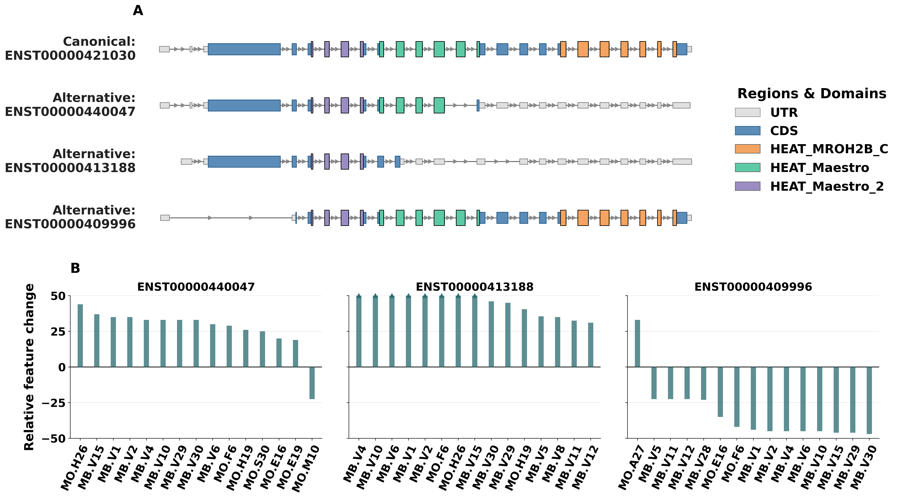
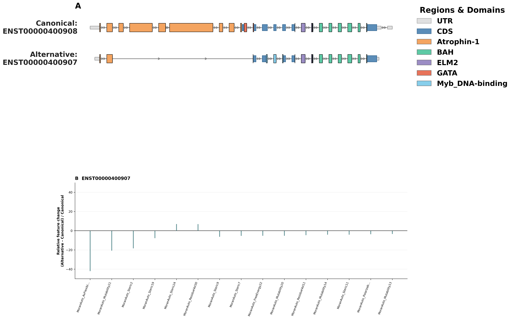

# IsoImpact

IsoImpact is an automated tool to evaluate the functional impact of alternative splicing based on isoform sequences. It integrates domain visualization across selected isoforms and protein feature analysis into a unified automated workflow.

## 1. Installation

Download IsoImpact from GitHub:

```bash
git clone https://github.com/HeBinYu666/IsoImpact.git
cd IsoImpact
```

IsoImpact is implemented in Python. It requires Python 3.8 or higher. The required Python packages are listed in `requirements.txt`:

```text
numpy==1.24.4
pandas==2.0.3
matplotlib==3.7.5
biopython==1.83
propy3==1.1.1
```

Install these packages with:

```bash
pip install -r requirements.txt
```

The fixed dependency versions above are the versions used for the reported analyses.

IsoImpact uses the fixed 966-feature schema documented in Supplementary Table S2.
For each feature, every output row contains the same `Can_*`, `Alt_*`, and raw `Delta_*` columns, interleaved in the fixed feature-list order.
If a feature cannot be calculated, its value and corresponding raw delta are written as `NA`.
Relative changes are still calculated in memory for ranking and visualization, but
`Normalized_Delta_*` columns are not written to `IsoImpact_features.csv`.

## 2. Command-line options

IsoImpact implements the following input options:

```text
-i   Ensembl isoform IDs to be compared. At least two isoform IDs are required.
-g   Path to the GTF annotation file.
-f   Path to the protein FASTA file.
-d   Path to the domain-coordinate file.
-o   Directory where output files will be saved. The default is the current directory.
```

The isoform IDs (`-i`) must match the supplied GTF file. The GTF file (`-g`) provides isoform, exon, CDS, UTR, gene, and protein ID annotations for the selected isoforms. The protein FASTA file (`-f`) provides the corresponding amino acid sequences. The domain-coordinate file (`-d`) provides the protein-domain annotations used for domain mapping and visualization. IsoImpact provides the following pre-built domain-coordinate files under the `data/` directory:

| Species | Annotation version | Domain-coordinate file |
| --- | --- | --- |
| Human (*Homo sapiens*) | Ensembl 110 | [human_domain_v110.csv](data/human_domain_v110.csv) |
| Mouse (*Mus musculus*) | Ensembl 110 | [mouse_domain_v110.csv](data/mouse_domain_v110.csv) |
| Rhesus macaque (*Macaca mulatta*) | Ensembl 116 | [rhesus_macaque_domain_v116.csv](data/rhesus_macaque_domain_v116.csv) |
| Fruit fly (*Drosophila melanogaster*) | Ensembl 116 (FlyBase gene set 63) | [fruit_fly_domain_v116.csv](data/fruit_fly_domain_v116.csv) |
| Rabbit (*Oryctolagus cuniculus*) | Ensembl 116 | [rabbit_domain_v116.csv](data/rabbit_domain_v116.csv) |
| Red deer (*Cervus elaphus*) | Ensembl Rapid Release 2023_08 | [red_deer_domain_v2023_08.csv](data/red_deer_domain_v2023_08.csv) |

Use a GTF file and protein FASTA file from the same species and annotation version as the selected domain-coordinate file. The human and mouse examples below use Ensembl release 110 to match their pre-built domain files.

### 2.1 Example usage for evaluating impact of isoforms in humans

Step 1. Download the Ensembl release version 110 human GTF and protein FASTA files:

```bash
mkdir -p references

curl -L -o references/Homo_sapiens.GRCh38.110.gtf.gz \
  https://ftp.ensembl.org/pub/release-110/gtf/homo_sapiens/Homo_sapiens.GRCh38.110.gtf.gz

curl -L -o references/Homo_sapiens.GRCh38.pep.all.fa.gz \
  https://ftp.ensembl.org/pub/release-110/fasta/homo_sapiens/pep/Homo_sapiens.GRCh38.pep.all.fa.gz

gunzip references/Homo_sapiens.GRCh38.110.gtf.gz
gunzip references/Homo_sapiens.GRCh38.pep.all.fa.gz
```

Step 2. Run IsoImpact with four human Ensembl isoform IDs from the ***MROH7*** gene (**ENSG00000184313**):

```bash
python IsoImpact.py \
  -i ENST00000421030 ENST00000440047 ENST00000413188 ENST00000409996 \
  -g references/Homo_sapiens.GRCh38.110.gtf \
  -f references/Homo_sapiens.GRCh38.pep.all.fa \
  -d data/human_domain_v110.csv \
  -o results/human_isoforms
```

Because this example compares human isoforms from Ensembl release 110, the command uses `data/human_domain_v110.csv`.

After the command is finished, IsoImpact writes the output figure to the file below:

```text
results/human_isoforms/IsoImpact_figure.png
```

`IsoImpact_figure.png` combines the transcript/domain map (A) and a top-15 relative feature-change plot for each isoform comparison (B). The 15 finite features with the largest absolute relative changes, `(Alternative - Canonical) / Canonical`, are selected and then arranged from the largest signed value to the smallest. Values are clipped to -50 and 50 for display only, with triangles marking values beyond the limits. Panel B displays up to three comparisons per row and adds rows when needed. The CSV retains the complete feature matrix. An output figure from the four human ***MROH7*** isoforms is available as [`data/example_output/IsoImpact_figure.png`](data/example_output/IsoImpact_figure.png).



IsoImpact also writes the feature matrix of all queried isoforms into the file below:

```text
results/human_isoforms/IsoImpact_features.csv
```

`IsoImpact_features.csv` contains gene and isoform information, protein features, genomic span, and domain comparison results.
The feature columns follow the fixed 966-feature schema from Supplementary Table S2; normalized relative-change values used for figure ranking are kept in memory and are not exported as CSV columns. To illustrate, part of the feature-matrix from four human ***MROH7*** isoforms is shown below. The complete table is available as [`data/example_output/IsoImpact_features.csv`](data/example_output/IsoImpact_features.csv).

| Gene ID | Canonical isoform | Alternative isoform | Alternative domains | Lost domains | Gained domains | Total domain change |
| --- | --- | --- | --- | --- | --- | ---: |
| ENSG00000184313 | ENST00000421030 | ENST00000440047 | HEAT_Maestro_2; HEAT_Maestro | HEAT_MROH2B_C | None | 1 |
| ENSG00000184313 | ENST00000421030 | ENST00000413188 | HEAT_Maestro_2 | HEAT_Maestro; HEAT_MROH2B_C | None | 2 |
| ENSG00000184313 | ENST00000421030 | ENST00000409996 | HEAT_Maestro_2; HEAT_Maestro; HEAT_MROH2B_C | None | None | 0 |

### 2.2  Example usage for evaluating impact of isoforms in mice
Step 1. Download the Ensembl release version 110 mouse GTF and protein FASTA files:

```bash
mkdir -p references

curl -L -o references/Mus_musculus.GRCm39.110.gtf.gz \
  https://ftp.ensembl.org/pub/release-110/gtf/mus_musculus/Mus_musculus.GRCm39.110.gtf.gz

curl -L -o references/Mus_musculus.GRCm39.pep.all.fa.gz \
  https://ftp.ensembl.org/pub/release-110/fasta/mus_musculus/pep/Mus_musculus.GRCm39.pep.all.fa.gz

gunzip references/Mus_musculus.GRCm39.110.gtf.gz
gunzip references/Mus_musculus.GRCm39.pep.all.fa.gz
```

Step 2. Run IsoImpact with two mouse isoforms from the mouse ***Cdh7*** gene (**ENSMUSG00000026312**):

```bash
python IsoImpact.py \
  -i ENSMUST00000112701 ENSMUST00000134301 \
  -g references/Mus_musculus.GRCm39.110.gtf \
  -f references/Mus_musculus.GRCm39.pep.all.fa \
  -d data/mouse_domain_v110.csv \
  -o results/mouse_isoforms
```

Because this example compares mouse isoforms from Ensembl release 110, the command uses `data/mouse_domain_v110.csv`.

## 3. Generating domain coordinates for other annotation versions and species

If no matching pre-built domain-coordinate file is provided in `data/`, users can use `scripts/build_custom_domain.R` when a matching species and Ensembl-release EnsDb entry is available in AnnotationHub. The script maps Pfam protein coordinates using that EnsDb database. Its `--gtf` argument records the downstream GTF path; it does not construct an EnsDb database from the GTF. The generated domain file must be used together with GTF and protein FASTA files from the same species and annotation version. The example below uses two isoforms from the ***RERE*** gene in Ensembl release 109 to showcase this process.

For this process, users need:

```text
1. A GTF file from the target Ensembl release version or species.
2. A protein FASTA file from the same Ensembl release version or species.
3. PfamScan domain-prediction results for the corresponding protein sequences.
```

First, install the R packages used by `scripts/build_custom_domain.R`:

```r
install.packages("BiocManager")
BiocManager::install(c("AnnotationHub", "ensembldb", "GenomicRanges"))
install.packages("dplyr")
```

Then follow these four steps to create genomic domain coordinates and run IsoImpact.

Step 1. Prepare the GTF and protein FASTA files.

Download the Ensembl release version 109 human GTF file:

```bash
mkdir -p references

curl -L -o references/Homo_sapiens.GRCh38.109.gtf.gz \
  https://ftp.ensembl.org/pub/release-109/gtf/homo_sapiens/Homo_sapiens.GRCh38.109.gtf.gz

gunzip references/Homo_sapiens.GRCh38.109.gtf.gz
```

To reduce the running time of the example workflow, we use the protein FASTA file containing a small number of proteins in this repository:

```text
data/example_release109/Homo_sapiens.GRCh38.pep.release109.example.fa
```

If users want to use the full proteome, they can also download the complete Ensembl release version 109 human protein FASTA file from Ensembl:

```text
https://ftp.ensembl.org/pub/release-109/fasta/homo_sapiens/pep/Homo_sapiens.GRCh38.pep.all.fa.gz
```

Step 2. Generate domain annotation using the pfam_scan.pl script.

First, install PfamScan:

```bash
conda create -n pfamscan -c conda-forge -c bioconda pfam_scan hmmer -y
conda activate pfamscan
```

Second, download and prepare the Pfam database:

```bash
mkdir -p references/pfam

curl -L -o references/pfam/Pfam-A.hmm.gz \
  https://ftp.ebi.ac.uk/pub/databases/Pfam/current_release/Pfam-A.hmm.gz

curl -L -o references/pfam/Pfam-A.hmm.dat.gz \
  https://ftp.ebi.ac.uk/pub/databases/Pfam/current_release/Pfam-A.hmm.dat.gz

curl -L -o references/pfam/active_site.dat.gz \
  https://ftp.ebi.ac.uk/pub/databases/Pfam/current_release/active_site.dat.gz

gunzip -f references/pfam/Pfam-A.hmm.gz
gunzip -f references/pfam/Pfam-A.hmm.dat.gz
gunzip -f references/pfam/active_site.dat.gz

hmmpress references/pfam/Pfam-A.hmm
```

Third, run PfamScan on the provided FASTA file:

```bash
mkdir -p results/release109_rere

pfam_scan.pl \
  -fasta data/example_release109/Homo_sapiens.GRCh38.pep.release109.example.fa \
  -dir references/pfam \
  -outfile results/release109_rere/RERE_release109_pfam_results.txt
```

Step 3. Generate an IsoImpact-compatible genomic coordinate file of domains:

```bash
Rscript scripts/build_custom_domain.R \
  --gtf references/Homo_sapiens.GRCh38.109.gtf \
  --pfam results/release109_rere/RERE_release109_pfam_results.txt \
  --out results/release109_rere/RERE_release109_domain.csv \
  --ensembl 109
```

Step 4. Run IsoImpact with two human Ensembl isoform IDs from the ***RERE*** gene (**ENSG00000142599**) and the generated domain-coordinate file:

```bash
python IsoImpact.py \
  -i ENST00000400908 ENST00000400907 \
  -g references/Homo_sapiens.GRCh38.109.gtf \
  -f data/example_release109/Homo_sapiens.GRCh38.pep.release109.example.fa \
  -d results/release109_rere/RERE_release109_domain.csv \
  -o results/release109_rere
```

After the command is finished, IsoImpact writes the output figure to:

```text
results/release109_rere/IsoImpact_figure.png
```

`IsoImpact_figure.png` contains the transcript/domain map and the top-15 relative feature-change plot described in Section 2.1. An output figure from two isoforms of the ***RERE*** gene in Ensembl release 109 is available as [`data/example_release109/RERE_release109_IsoImpact_figure.png`](data/example_release109/RERE_release109_IsoImpact_figure.png).



IsoImpact also writes the feature matrix to:

```text
results/release109_rere/IsoImpact_features.csv
```

`IsoImpact_features.csv` contains gene and isoform information, protein features, genomic span, and domain comparison results. Part of the feature matrix of the two isoforms of ***RERE*** is shown below. The complete table is available as [`data/example_release109/RERE_release109_IsoImpact_features.csv`](data/example_release109/RERE_release109_IsoImpact_features.csv).

| Gene ID | Canonical isoform | Alternative isoform | Alternative domains | Lost domains | Gained domains | Total domain change |
| --- | --- | --- | --- | --- | --- | ---: |
| ENSG00000142599 | ENST00000400908 | ENST00000400907 | BAH; ELM2; Myb_DNA-binding; Atrophin-1 | GATA | Myb_DNA-binding | 2 |

## 4. Contact

If any questions about using IsoImpact, please contact:

- Bin-Yu He: hzb022119@163.com
- Hong-Dong Li: hongdong@csu.edu.cn

You can also click the **Issues** tab at the top of this GitHub page to report problems.
